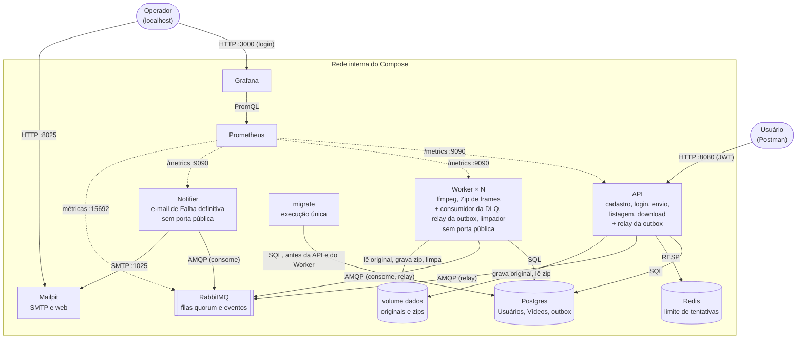
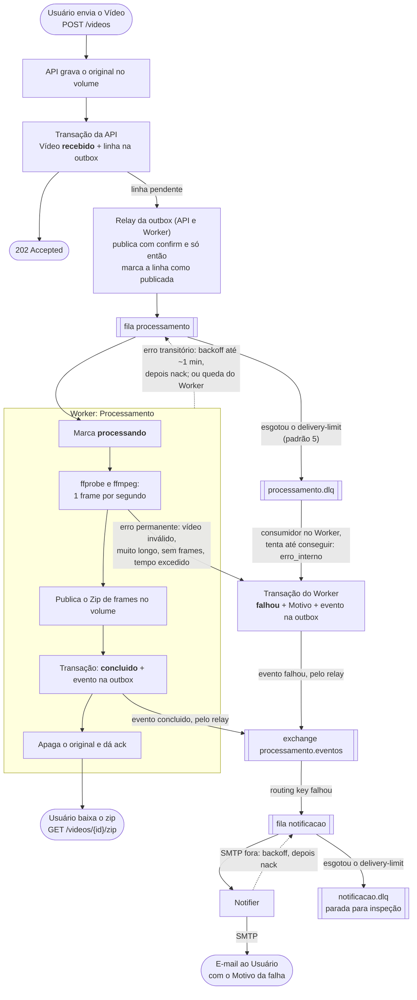
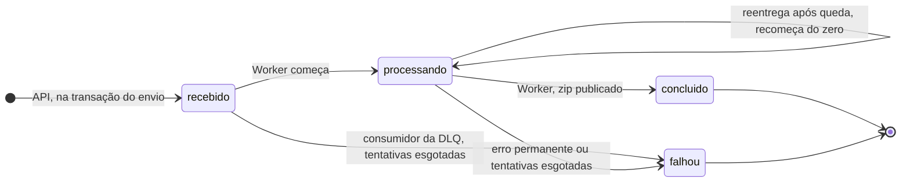

# Diagramas da arquitetura

Vocabulário do [glossário](../../GLOSSARY.md); as decisões estão nos [ADRs](../adr/).

## Componentes

Todos os containers do [`docker-compose.yml`](../../docker-compose.yml) e quem fala com quem. A seta sai de quem inicia a conexão. Só três portas saem da rede do Compose: a da API e, apenas em localhost, a do Grafana e a do Mailpit. Worker e Notifier não têm porta pública ([ADR-0001](../adr/0001-api-worker-notifier.md)).

API e Worker dividem o Postgres e o volume; o Notifier não acessa nenhum dos dois. A porta interna `9090` de cada processo serve `/metrics`, `/healthz` e `/readyz` ([ADR-0010](../adr/0010-observabilidade-prometheus-grafana.md)).

## Fluxo de um Vídeo

Do envio até o fim, em `concluido` ou `falhou`. A mensagem só carrega `video_id` e `correlation_id`; os bytes ficam no volume ([ADR-0002](../adr/0002-rabbitmq-mensageria.md), [ADR-0003](../adr/0003-transactional-outbox.md), [ADR-0004](../adr/0004-retry-e-dlq.md), [ADR-0008](../adr/0008-notificacao-por-email.md)).

A entrega é pelo menos uma vez e o Worker é idempotente: se o Vídeo já é terminal, ele só dá ack. O evento `concluido` ainda não tem assinante.

## Estados do Vídeo

As transições do [ADR-0014](../adr/0014-ciclo-de-vida-do-video.md). Só andam para a frente: cada uma é um `UPDATE … WHERE status IN (<origens permitidas>)`.

`recebido` e `processando` contam na Cota. `concluido` e `falhou` são finais: não há cancelamento, nem novo Processamento do mesmo Vídeo. A expiração do Zip de frames não muda o status ([ADR-0015](../adr/0015-retencao-e-limpeza.md)).
